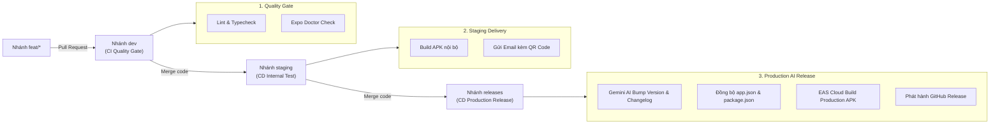

# 🐾 9Paws Mobile Application

<div align="center">

  

  <h3>Chi tiêu nhẹ nhàng & Chia bill dễ dàng</h3>
  <p><em>Effortless Personal Expenses & Smart Group Bill Splitting with Miu Miu Companion</em></p>

  [](https://reactnative.dev/)
  [](https://expo.dev/)
  [](https://www.typescriptlang.org/)
  [](https://www.nativewind.dev/)
  [](https://zustand-demo.pmnd.rs/)
  [](https://nodejs.org/)
  [](https://github.com/features/actions)

</div>

---

## 📖 Mục lục (Table of Contents)

1. [Giới thiệu dự án (Overview)](#-giới-thiệu-dự-án-overview)
2. [Tính năng cốt lõi (Key Features)](#-tính-năng-cốt-lõi-key-features)
3. [Công nghệ & Kiến trúc (Tech Stack)](#-công-nghệ--kiến-trúc-tech-stack)
4. [Cấu trúc thư mục (Project Structure)](#-cấu-trúc-thư-mục-project-structure)
5. [Hướng dẫn cài đặt & Chạy ứng dụng (Getting Started)](#-hướng-dẫn-cài-đặt--chạy-ứng-dụng-getting-started)
6. [Cấu hình biến môi trường (Environment Variables)](#-cấu-hình-biến-môi-trường-environment-variables)
7. [Các lệnh thông dụng (Available Scripts)](#-các-lệnh-thông-dụng-available-scripts)
8. [Quy trình CI/CD & Auto-Release (DevOps Pipeline)](#-quy-trình-cicd--auto-release-devops-pipeline)
9. [Tuân thủ Pháp lý & Quy định tại Việt Nam (Legal & Regulatory Compliance)](#-tuân-thủ-pháp-lý--quy-định-tại-việt-nam-legal--regulatory-compliance)
10. [Quy chuẩn đóng góp mã nguồn (Contributing & Conventional Commits)](#-quy-chuẩn-đóng-góp-mã-nguồn-contributing--conventional-commits)
11. [Đội ngũ phát triển & Bản quyền (Team & License)](#-đội-ngũ-phát-triển--bản-quyền-team--license)

---

## 🌟 Giới thiệu dự án (Overview)

**9Paws** là ứng dụng di động quản lý tài chính cá nhân và chia hoá đơn nhóm thông minh, được xây dựng trên nền tảng **React Native** & **Expo SDK 58**. Dự án ra đời với mong muốn giải quyết những bất tiện thường ngày của sinh viên và giới trẻ:
- Sự ngại ngùng, phức tạp và dễ nhầm lẫn khi chia tiền ăn uống, du lịch, sinh hoạt nhóm.
- Cảm giác khô khan, áp lực khi ghi chép sổ thu chi hàng ngày.

Với sự đồng hành của linh vật mèo **Miu Miu**, 9Paws mang đến trải nghiệm tài chính ấm áp, trực quan, minh bạch và an toàn tuyệt đối.

---

## ✨ Tính năng cốt lõi (Key Features)

### 💰 1. Quản lý Thu Chi & Đa nguồn tiền (Multi-wallet & Multi-currency)
- Phân loại thu chi linh hoạt theo nguồn: **Tiền mặt (Cash)**, **Tài khoản Ngân hàng (Bank)**, **Ví điện tử (E-Wallet)**.
- Hỗ trợ đa đơn vị tiền tệ quốc tế: `VND (đ)`, `USD ($)`, `EUR (€)`, `JPY (¥)`, `GBP (£)`, `SGD (S$)`, `KRW (₩)`, `CNY (¥)`.
- Biểu đồ thống kê dòng tiền trực quan, theo dõi số dư tức thời.

### 🧾 2. Chia hoá đơn nhóm tự động (Smart Group Bill Splitting)
- Thuật toán tối ưu hoá quyết toán thông minh: Tự động tính toán số tiền mỗi thành viên cần trả/nhận, giảm thiểu tối đa số lượt giao dịch chuyển khoản trung gian.
- Chia đều (Equal Split), chia theo tỷ lệ hoặc chia chính xác theo từng món ăn/dịch vụ.

### 🔐 3. Bảo mật đa lớp & Xác thực sinh trắc học
- **Xác thực bảo mật:** Đăng nhập truyền thống (Email/Password với JWT access/refresh token) hoặc đăng nhập nhanh bằng **Google Sign-In SDK** (Google One Tap / Native Credential Manager).
- **Liên kết tài khoản linh hoạt:** Hỗ trợ tính năng Dual-login (liên kết tài khoản Google trực tiếp vào tài khoản Email hiện hữu).
- **Sinh trắc học an toàn:** Mở khoá ứng dụng bằng **Face ID / Vân tay** tích hợp phần cứng an toàn (`expo-local-authentication` kết hợp `expo-secure-store`).

### 🐱 4. Miu Miu đồng hành & Nhắc nhở thông minh
- Linh vật Miu Miu theo sát số ngày đồng hành của bạn.
- Hệ thống thông báo nhắc nhở ghi chép chi tiêu định kỳ mỗi tối, giúp rèn luyện thói quen quản lý tài chính lành mạnh.

### 🌐 5. Tự động nhận diện ngôn ngữ thiết bị (Auto Device-Locale Sync)
- Ứng dụng tự động phát hiện ngôn ngữ của hệ điều hành:
  - Nếu máy cài đặt **Tiếng Việt (`vi`)** -> Giao diện hiển thị Tiếng Việt.
  - Tất cả các ngôn ngữ khác -> Tự động kích hoạt **Tiếng Anh (`en`)**.
- Không phát sinh cấu hình dư thừa, trải nghiệm liền mạch ngay lần mở app đầu tiên.

### 🎨 6. UI/UX Hiện đại & Responsive đa màn hình
- Thiết kế chuẩn Mobile-first, tương thích tối đa từ màn hình nhỏ (compact) đến màn hình dài (tall aspect ratio) thông qua hook responsive riêng biệt.
- Màn hình Splash Screen hoạt ảnh (`AnimatedSplashScreen`) sống động với dấu chân mèo Miu Miu mượt mà.

---

## 🛠 Công nghệ & Kiến trúc (Tech Stack)

| Hạng mục | Công nghệ sử dụng | Mục đích / Ưu điểm |
|---|---|---|
| **Core Framework** | **Expo SDK 58** (CNG) | Nền tảng phát triển ứng dụng di động đa nền tảng hiện đại nhất, không chỉnh sửa trực tiếp mã native `android/` hoặc `ios/`. |
| **Mobile Runtime** | **React Native 0.88.1** & **React 19** | Hiệu năng native tối đa với New Architecture và công nghệ render mới nhất. |
| **Navigation** | **Expo Router v4** | File-based routing tương tự Next.js, điều hướng mượt mà, type-safe navigation. |
| **Styling** | **NativeWind v4** & **Tailwind CSS 3.4** | Thiết kế giao diện utility-first nhanh chóng, dễ bảo trì, hỗ trợ responsive hoàn hảo. |
| **State Management** | **Zustand v5** | Quản lý state gọn nhẹ, hiệu suất cao, không boilerplate. |
| **Data Fetching** | **Axios** + **TanStack Query v5** | Tự động intercept Bearer Token, xếp hàng (queue) refresh token khi gặp mã lỗi 401. |
| **Authentication** | `@react-native-google-signin/google-signin` | Đăng nhập Google One Tap native trên thiết bị thật, tự động fallback an toàn trên Expo Go. |
| **Local Security** | `expo-secure-store` & `expo-local-authentication` | Lưu trữ khóa mã hóa và token trong Android Keystore / iOS Keychain; xác thực Face ID/Vân tay. |
| **Internationalization** | `i18next`, `react-i18next`, `expo-localization` | Đa ngôn ngữ đồng bộ, fallback thông minh, nạp bản dịch theo luồng thiết bị. |
| **Typography & Icons** | `@expo-google-fonts/be-vietnam-pro`, `lucide-react-native` | Bộ font tiếng Việt chuyên nghiệp BeVietnamPro kết hợp icon vector sắc nét. |

---

## 📁 Cấu trúc thư mục (Project Structure)

```text
APP.9Paws-FE/
├── .github/
│   ├── scripts/
│   │   └── ai-release-bump.py      # Script Gemini AI tự động bump version & viết changelog
│   └── workflows/
│       ├── ci-dev-gate.yml         # CI kiểm tra chất lượng code trên PR vào nhánh dev
│       ├── cd-staging.yml          # CD build APK nội bộ & gửi mail kèm mã QR trên nhánh staging
│       └── cd-release.yml          # CD Production AI auto-version & EAS Cloud build trên nhánh releases
├── assets/
│   ├── images/                     # Ảnh biểu tượng mascot Miu Miu, splash screen, onboarding
│   └── fonts/                      # Font chữ dự án
├── src/
│   ├── app/                        # Expo Router Pages (Mỗi file đại diện cho một màn hình)
│   │   ├── (auth)/                 # Cụm màn hình xác thực: login, register, forgot-password, otp
│   │   ├── (tabs)/                 # Tab Navigator chính: overview, expense, split-bill, profile
│   │   ├── _layout.tsx             # Root layout cấu hình Splash, Auth Guard, Biometrics & i18n
│   │   ├── about.tsx               # Màn hình Về 9Paws, version tự động & Tuân thủ pháp lý Việt Nam
│   │   └── edit-profile.tsx        # Màn hình Chỉnh sửa hồ sơ, avatar & inline validation
│   ├── components/
│   │   └── ui/                     # UI atoms/molecules: AnimatedSplashScreen, GoogleIcon, OtpInput, Toast...
│   ├── hooks/
│   │   └── useResponsive.ts        # Hook tính toán padding, typography linh hoạt theo kích thước màn hình
│   ├── i18n/
│   │   ├── locales/                # Bản dịch: en.json, vi.json
│   │   └── index.ts                # Cấu hình i18n đồng bộ, auto-detect ngôn ngữ thiết bị
│   ├── lib/
│   │   ├── api.ts                  # Axios client với Interceptor tự động refresh token
│   │   ├── constants.ts            # Hằng số cấu hình hệ thống, storage keys
│   │   ├── secure-storage.ts       # Module bọc Expo SecureStore an toàn
│   │   └── suppress-warnings.ts    # Lọc các warning deprecation ngoại vi trong môi trường dev
│   ├── services/
│   │   ├── auth.service.ts         # Gọi API đăng nhập, đăng ký, refresh token, đổi mật khẩu
│   │   ├── google-auth.service.ts  # Tương tác Google Sign-In SDK & Android Credential Manager
│   │   ├── notification.service.ts # Đăng ký quyền thông báo đẩy cục bộ/remote
│   │   └── user.service.ts         # Gọi API thông tin cá nhân, cập nhật profile, link Google
│   ├── stores/
│   │   ├── auth.store.ts           # Global store quản lý session người dùng & trạng thái đăng nhập
│   │   └── toast.store.ts          # Global store hiển thị thông báo Toast
│   └── types/                      # TypeScript definitions (Auth, User, Response, Common)
├── app.json                        # Cấu hình chính của Expo App & Version
├── babel.config.js                 # Cấu hình Babel compiler
├── eslint.config.js                # Bộ quy tắc lint code
├── package.json                    # Dependencies & Scripts
├── tailwind.config.ts              # Bảng màu thương hiệu (Brand Orange, Accent...)
└── tsconfig.json                   # Cấu hình TypeScript compiler
```

---

## 🚀 Hướng dẫn cài đặt & Chạy ứng dụng (Getting Started)

### 1. Yêu cầu hệ thống (Prerequisites)
- **Node.js**: Phiên bản `>= 22.0.0` (Khuyến nghị dùng bản LTS).
- **Package Manager**: `npm` hoặc `bun`.
- **EAS CLI**: Cài đặt toàn cục để build native:
  ```bash
  npm install -g eas-cli
  ```
- **Thiết bị chạy thử nghiệm**:
  - Máy ảo Android Emulator / iOS Simulator, hoặc
  - Điện thoại vật lý cài ứng dụng **Expo Go** (từ Google Play / App Store) hoặc bản **Development Build**.

### 2. Cài đặt các bước chi tiết

```bash
# 1. Clone repository
git clone https://github.com/9Paws/APP.9Paws-FE.git
cd APP.9Paws-FE

# 2. Tạo file cấu hình môi trường từ bản mẫu
cp .env.example .env

# 3. Cài đặt toàn bộ dependencies (Đảm bảo đúng phiên bản SDK 58 tương thích)
npx expo install

# 4. Khởi động Expo Development Server
npx expo start
```

### 3. Trải nghiệm trên thiết bị
- Nhấn phím `a` trên Terminal để mở trên **Android Emulator**.
- Nhấn phím `i` trên Terminal để mở trên **iOS Simulator**.
- Hoặc quét mã QR hiển thị trên Terminal bằng camera (iOS) hoặc ứng dụng Expo Go (Android).

> 💡 **Lưu ý về Google Sign-In:** 
> Do module `@react-native-google-signin/google-signin` sử dụng native code trực tiếp từ Google Play Services, tính năng đăng nhập Google yêu cầu bản **Development Build** (`npx expo run:android` hoặc cài đặt file APK staging do CI/CD sinh ra). Khi chạy trên Expo Go thông thường, ứng dụng sẽ tự động hiển thị banner thông báo thân thiện mà không gây crash app.

---

## 🔑 Cấu hình biến môi trường (Environment Variables)

File mẫu [`.env.example`](file:///.env.example) định nghĩa các tham số cần thiết:

| Tên biến | Bắt buộc | Mô tả & Hướng dẫn lấy |
|---|:---:|---|
| `EXPO_PUBLIC_API_BASE_URL` | **Có** | Endpoint gốc của Backend API (ví dụ: `https://api.yourdomain.com/api/v1`). |
| `EXPO_PUBLIC_GOOGLE_WEB_CLIENT_ID` | **Có** | OAuth 2.0 Web Client ID lấy từ Google Cloud Console (loại *Web application* khớp với Backend để xác thực `idToken`). |

> ⚠️ **Quy tắc bảo mật:** File `.env` chứa thông tin thực tế đã được khai báo trong `.gitignore`. Tuyệt đối không commit file `.env` lên GitHub.

---

## 📜 Các lệnh thông dụng (Available Scripts)

```bash
# Khởi động Metro bundler
npm run start

# Mở nhanh trên Android Emulator
npm run android

# Mở nhanh trên iOS Simulator
npm run ios

# Kiểm tra cú pháp và quy chuẩn mã nguồn (ESLint)
npm run lint

# Kiểm tra chặt chẽ toàn bộ kiểu dữ liệu TypeScript (Zero Error Policy)
npm run typecheck

# Chẩn đoán sức khỏe dependencies và cấu hình Expo
npx expo-doctor

# Tự động sửa chữa tương thích phiên bản package với Expo SDK 58
npx expo install --fix
```

---

## 🤖 Quy trình CI/CD & Auto-Release (DevOps Pipeline)

Repository áp dụng mô hình tự động hoá DevOps 3 tầng hiện đại với GitHub Actions:



1. **`ci-dev-gate.yml` (Nhánh `dev`)**: Tự động kích hoạt khi có Pull Request vào `dev`. Chạy Lint, Typecheck và Expo Doctor để chặn lỗi trước khi merge.
2. **`cd-staging.yml` (Nhánh `staging`)**: Tự động build file APK thử nghiệm nội bộ, tối ưu hoá bộ nhớ cache Gradle và gửi email thông báo kèm đường dẫn tải/mã QR cho tester.
3. **`cd-release.yml` (Nhánh `releases`)**:
   - Sử dụng **Google Gemini AI** phân tích 15 git commit gần nhất để quyết định bump version (`minor` hay `patch`).
   - Tự động viết **Changelog** bằng tiếng Việt trang trọng, chuẩn chỉ.
   - Tự động cập nhật `app.json` và `package.json`, tạo Git Tag `vX.Y.Z`.
   - Kích hoạt **EAS Cloud** build file APK Production chính thức và đính kèm vào GitHub Releases.

---

## ⚖️ Tuân thủ Pháp lý & Quy định tại Việt Nam (Legal & Regulatory Compliance)

Ứng dụng 9Paws được phát triển và vận hành tuân thủ nghiêm ngặt hệ thống pháp luật của nước Cộng hòa Xã hội Chủ nghĩa Việt Nam:

### 1. Bảo vệ Dữ liệu Cá nhân — Nghị định 13/2023/NĐ-CP (PDPD)
- **Nguyên tắc thu thập tối giản:** Chỉ thu thập các thông tin cơ bản phục vụ đăng nhập (Họ tên, Email, Số điện thoại do người dùng tự nguyện cung cấp). Tuyệt đối **không** thu thập số CCCD, tài khoản ngân hàng hay mật khẩu giao dịch.
- **Tôn trọng quyền của Chủ thể Dữ liệu (Điều 9):** Người dùng có toàn quyền xem, chỉnh sửa, yêu cầu trích xuất hoặc **yêu cầu xoá vĩnh viễn dữ liệu và tài khoản** (Right to Erasure) bất cứ khi nào.
- **Cam kết không thương mại hóa:** Tuyệt đối không mua bán, cho thuê hay tiết lộ dữ liệu tài chính của người dùng cho bất kỳ bên thứ ba nào vì mục đích thương mại.

### 2. Tuyên bố Dịch vụ Tài chính & Miễn trừ trách nhiệm — Nghị định 52/2024/NĐ-CP
- **Bản chất phần mềm:** 9Paws là công cụ phần mềm hỗ trợ tính toán, ghi chép và chia sẻ chi phí thuần tuý.
- **Tuyên bố phi trung gian tài chính:** 9Paws **KHÔNG PHẢI là ngân hàng, tổ chức tín dụng, ví điện tử hay tổ chức cung ứng dịch vụ trung gian thanh toán** theo Nghị định số 52/2024/NĐ-CP.
- **Không giữ tiền:** Ứng dụng không mở tài khoản thanh toán, không giữ hộ tiền và không trực tiếp thực hiện giao dịch chuyển khoản thay người dùng. Mọi thao tác chuyển khoản (nếu có) đều do người dùng tự chủ động thực hiện trực tiếp giữa các tài khoản ngân hàng chính thức của mình.

### 3. Bảo vệ Quyền lợi Người tiêu dùng — Luật số 19/2023/QH15
- Cung cấp thông tin minh bạch, không cài cắm chi phí ẩn.
- Thiết lập kênh tiếp nhận ý kiến đóng góp, hỗ trợ kỹ thuật và giải quyết khiếu nại chính thức qua email: **`support@9paws.com`** với cam kết phản hồi đúng thời hạn luật định.

### 4. An toàn Thông tin Mạng — Luật An ninh mạng 2018
- Toàn bộ kết nối giữa ứng dụng và máy chủ được mã hóa bảo vệ theo tiêu chuẩn HTTPS/TLS 1.3.
- Dữ liệu xác thực sinh trắc học (vân tay, Face ID) được xử lý hoàn toàn cục bộ trên phần cứng bảo mật của thiết bị (Android Keystore / iOS Keychain), không bao giờ truyền về server.

---

## 🤝 Quy chuẩn đóng góp mã nguồn (Contributing & Conventional Commits)

Chúng tôi áp dụng quy tắc [Conventional Commits](https://www.conventionalcommits.org/) cho mọi thay đổi mã nguồn:

### Cú pháp thông điệp commit:
```text
<loại>(<phạm vi>): <mô tả ngắn gọn bằng thể mệnh lệnh>

[nội dung chi tiết nếu có]
```

### Các loại commit hợp lệ:
- `feat`: Tính năng mới (ví dụ: `feat(auth): integrate google sign-in sdk`).
- `fix`: Sửa lỗi (ví dụ: `fix(i18n): sync initialization to prevent warning`).
- `chore`: Cập nhật cấu hình, build tool, dependencies (ví dụ: `chore(deps): bump expo sdk 58`).
- `ci`: Thay đổi liên quan đến GitHub Actions, pipeline CI/CD.
- `docs`: Cập nhật tài liệu, README.
- `refactor`: Tái cấu trúc mã nguồn mà không thay đổi tính năng bên ngoài.
- `style`: Định dạng mã nguồn, khoảng trắng, dấu chấm phẩy (không ảnh hưởng logic).

---

## 👥 Đội ngũ phát triển & Bản quyền (Team & License)

### Đơn vị & Tác giả phát triển:
- **Đơn vị đào tạo**: Trường Đại học Công nghệ Thông tin (UIT - VNU-HCM).
- **Nguyễn Đại Hưng**: Đồng sáng lập & Lập trình viên chính (Lead Mobile Developer).
- **Hoàng Đức Chính**: Đồng sáng lập & Lập trình viên chính (Core Backend & Infrastructure).

---

<div align="center">
  <p>Được phát triển với tất cả tâm huyết và tình yêu mèo 🐱🐾</p>
  <p><strong>Copyright © 2026 9Paws Team. All Rights Reserved.</strong></p>
</div>
